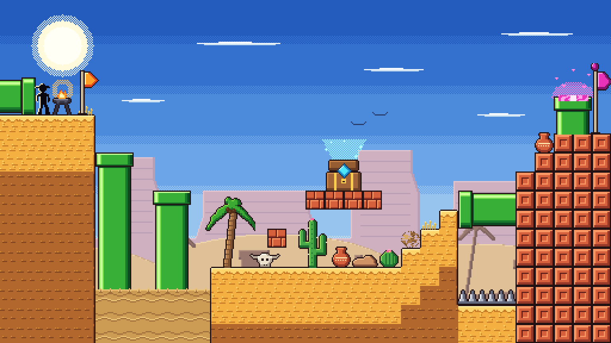

# Escenario Pixel Art - Desierto de Tuberías

Escenario en pixel art para un videojuego 2D de scroll lateral, montado en Unity.
La temática es un desierto con tuberías al estilo de los plataformas clásicos: arena, cactus, palmeras, una pirámide de bloques y tuberías verdes que forman parte del recorrido.



## Archivos de la entrega

| Pide la actividad | Archivo |
|---|---|
| Escenario completo en PNG a resolución original (512 x 288) | [`Entrega/escenario_desierto_tuberias.png`](Entrega/escenario_desierto_tuberias.png) |
| Archivo editable con las capas organizadas y nombradas | [`Entrega/escenario_desierto_tuberias_capas.psd`](Entrega/escenario_desierto_tuberias_capas.psd) |
| Tileset y elementos decorativos en un PNG aparte con transparencia | [`Assets/Art/tileset_y_decoraciones.png`](Assets/Art/tileset_y_decoraciones.png) |

El resto de archivos son el proyecto de Unity donde está montado el escenario.

## Datos del escenario

- Resolución original: 512 x 288 px (16:9)
- Tiles de 16 x 16 px (32 columnas x 18 filas)
- Luz principal arriba a la izquierda (donde está el sol). En todos los elementos los bordes de arriba y de la izquierda son más claros y los de abajo y la derecha más oscuros.
- Sin desenfoques ni suavizado. El cielo usa franjas con tramado en damero en lugar de degradados.

## Planos

| Plano | Contenido |
|---|---|
| Fondo lejano | Mesetas con franjas (más atrás) y dunas (más cerca), en colores apagados y con poco contraste |
| Fondo intermedio | Dunas oscuras y siluetas de cactus, palmeras y tuberías |
| Terreno jugable | Arena con borde superior iluminado, bloques de relleno, ladrillos, bloques de la pirámide, tuberías, arenas movedizas y pinchos. Es el único plano con contorno oscuro y los colores más saturados, para que se distinga del fondo |

## Recorrido

1. **Inicio** (arriba a la izquierda): el personaje sale de una tubería horizontal en lo alto de un acantilado. Hay un brasero y una bandera naranja.
2. **Bajada por tuberías**: dos tuberías a distinta altura, hundidas en arenas movedizas (peligro).
3. **Valle**: zona baja con decoración del desierto.
4. **Punto de interés**: un cofre abierto con luz cian sobre una isla flotante de ladrillos. Se llega desde un bloque suelto.
5. **Escalones de arena** hacia arriba.
6. **Foso con pinchos** que se cruza por encima de una tubería horizontal.
7. **Final** (arriba a la derecha): una pirámide escalonada con una tubería de salida con remolino magenta y la bandera de meta.

Cada zona tiene su color para guiar la mirada: naranja en el inicio, cian en el punto de interés y magenta en el final.

## Elementos decorativos

Palmera, cactus saguaro, cactus bola, cráneo, vasijas, rodamundos, hierba seca y rocas de arenisca. Además, en las zonas importantes: brasero, banderas, cofre y tubería de salida.

## Personaje

Silueta negra de unos 26 px de alto en la zona de inicio, con un borde de luz en el lado izquierdo. Sirve como referencia de escala.

## Capas

Las imágenes de `Assets/Art` son las capas del escenario, en este orden (de atrás hacia delante):

| Capa | Order in Layer |
|---|---|
| 01_Cielo | 0 |
| 02_Fondo_lejano | 1 |
| 03_Fondo_intermedio | 2 |
| 04_Terreno_jugable | 3 |
| 05_Decoracion | 4 |
| 06_Inicio_PuntoInteres_Final | 5 |
| 07_Personaje_escala | 6 |

También están `tileset_y_decoraciones.png` (tiles y decoraciones con fondo transparente) y `vista_previa_x3.png` (el escenario ampliado x3 con vecino más próximo).

## Estructura del proyecto

```
Entrega/
├── escenario_desierto_tuberias.png          Escenario completo (512 x 288)
├── escenario_desierto_tuberias_capas.psd    Archivo editable con las 7 capas
└── vista_previa_x3.png                      Vista ampliada x3 (solo para verlo en grande)
Assets/
├── Art/        Capas del escenario, tileset y vista previa
├── Scenes/     SampleScene (escena con el escenario montado)
├── Script/     PlayerController.cs
└── Settings/   Configuración de URP 2D e Input System
```

## Controles

El script `PlayerController.cs` permite mover al jugador:

- **A / D** o **flechas**: moverse a izquierda y derecha
- **Espacio**: saltar

Usa el Input System nuevo de Unity.

## Cómo abrirlo

1. Clonar el repositorio.
2. Abrirlo desde Unity Hub con **Unity 6 (6000.6.10f1)**.
3. Abrir la escena `Assets/Scenes/SampleScene.unity` y darle a Play.

## Autor

Pablo Barrera Corbacho - 2º DAW, Ilerna Sevilla